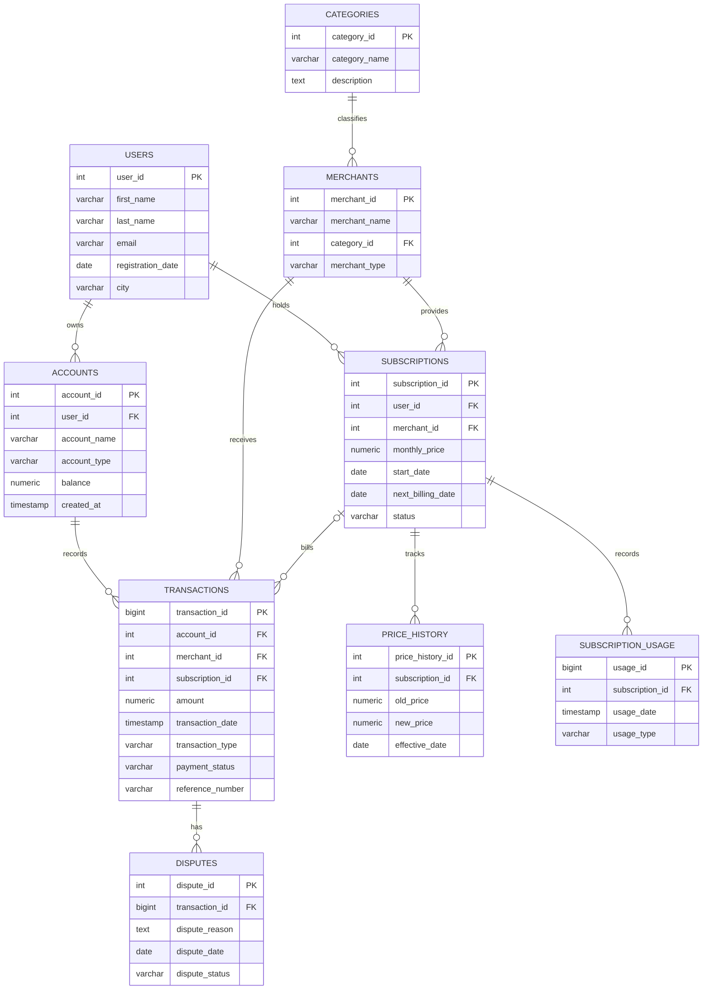
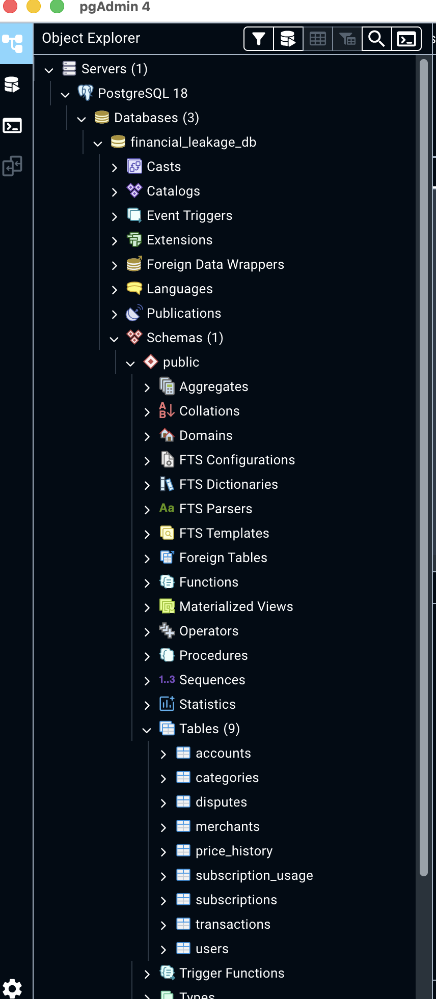
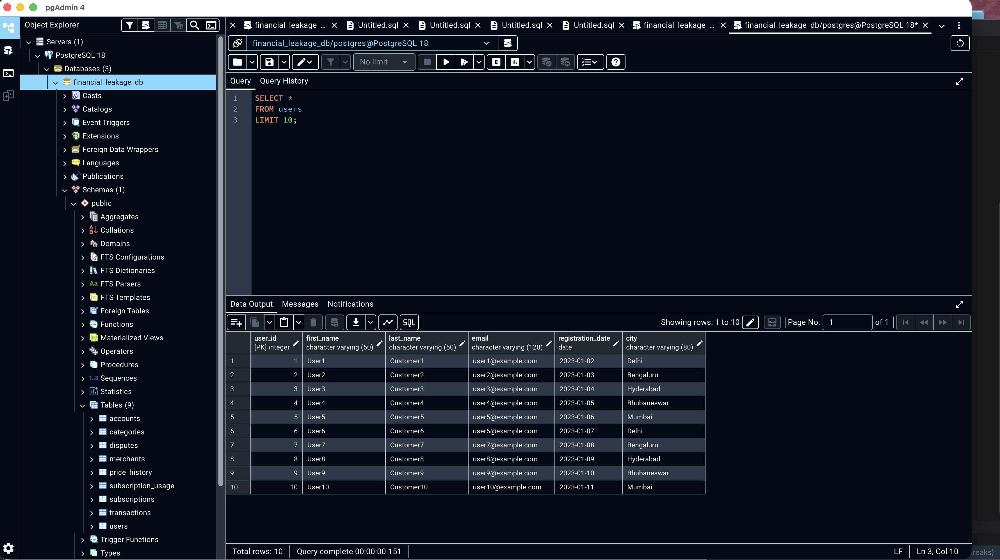
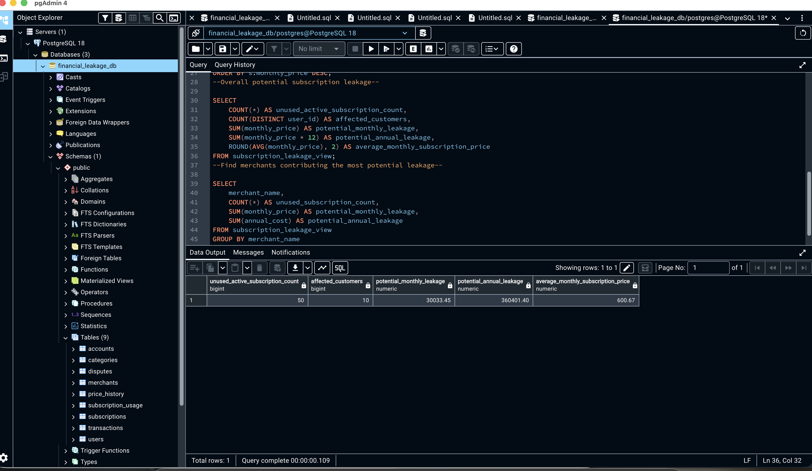
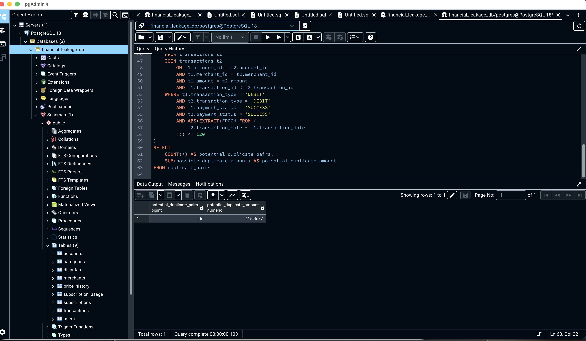
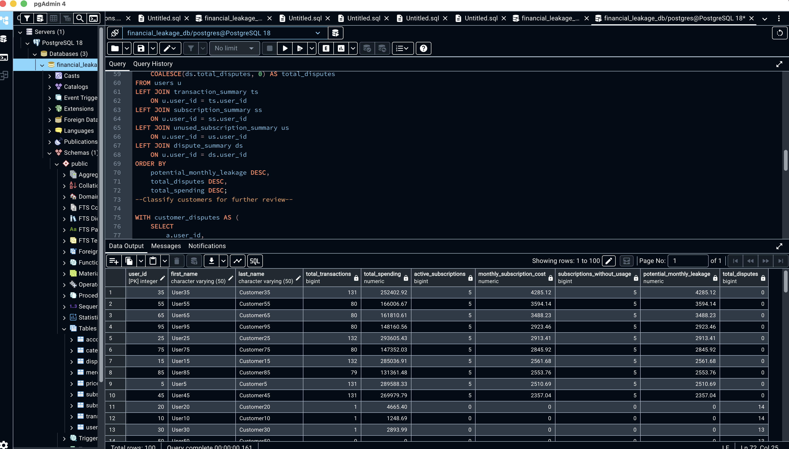
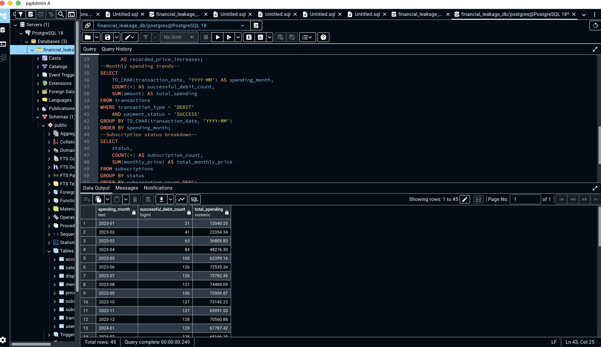
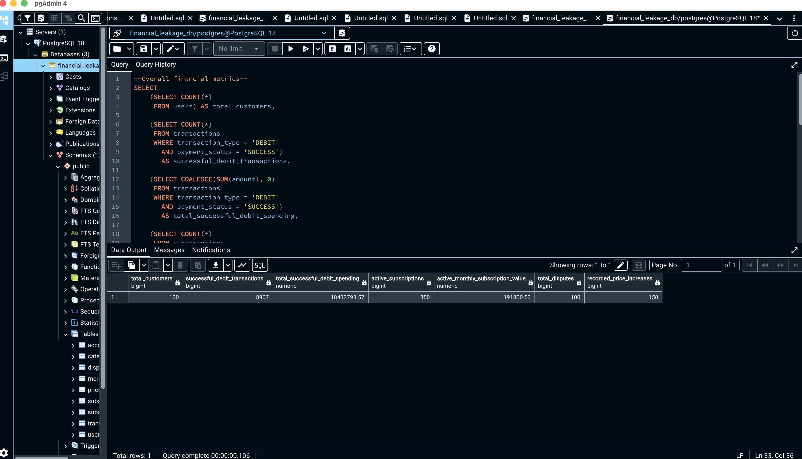
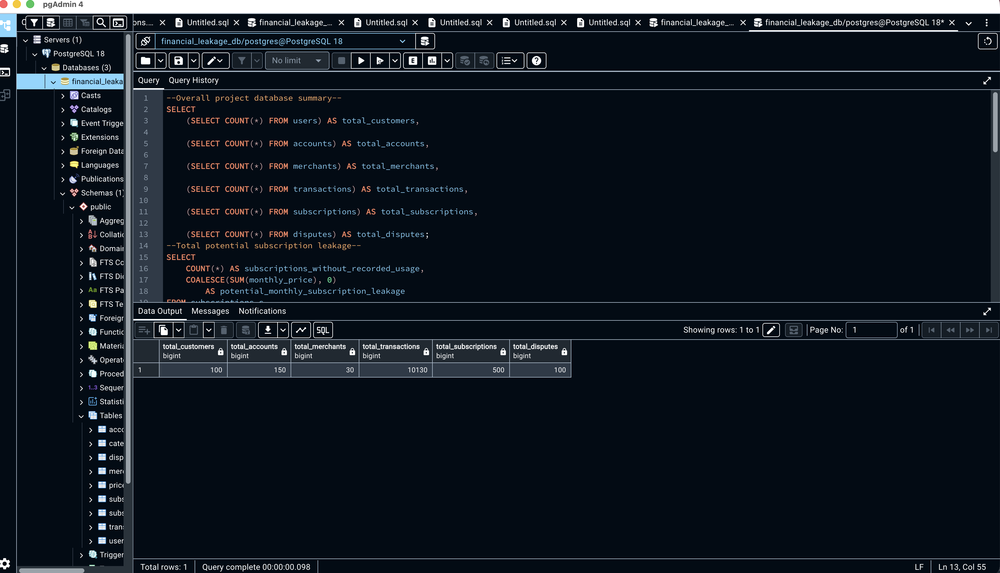

# Financial Leakage & Subscription Trap Detector

**A PostgreSQL financial analytics project for identifying potential subscription leakage, duplicate payment patterns, customer spending behaviour, price changes, and disputed transactions.**

<p align="left">
  
  
  
  
  
</p>

## Table of Contents

1. [Project Overview](#1-project-overview)
2. [Business Problem](#2-business-problem)
3. [Project Objectives](#3-project-objectives)
4. [Key Features](#4-key-features)
5. [Technology Stack](#5-technology-stack)
6. [Database Architecture](#6-database-architecture)
7. [Entity Relationship Diagram](#7-entity-relationship-diagram)
8. [Database Tables Overview](#8-database-tables-overview)
9. [Dataset Overview and Statistics](#9-dataset-overview-and-statistics)
10. [Project Workflow](#10-project-workflow)
11. [SQL Concepts Demonstrated](#11-sql-concepts-demonstrated)
12. [Business Questions Investigated](#12-business-questions-investigated)
13. [Analysis and Key Findings](#13-analysis-and-key-findings)
14. [Final Financial Overview](#14-final-financial-overview)
15. [Project Screenshots and Evidence](#15-project-screenshots-and-evidence)
16. [Repository Structure](#16-repository-structure)
17. [Installation and Execution Instructions](#17-installation-and-execution-instructions)
18. [How to Run the Project](#18-how-to-run-the-project)
19. [Limitations](#19-limitations)
20. [Future Improvements](#20-future-improvements)
21. [Key Learnings](#21-key-learnings)
22. [Author and Acknowledgements](#22-author-and-acknowledgements)

---

## 1. Project Overview

The **Financial Leakage & Subscription Trap Detector** is a relational database and financial analytics project built with PostgreSQL and pgAdmin 4. It uses a synthetic financial dataset to investigate recurring subscription costs, transactions, customer expenditure, merchant activity, price history, and payment disputes.

The database is designed around nine related tables. SQL queries are used to move from raw transactional records to business-oriented outputs, including:

- Active subscriptions with no corresponding usage record.
- Potential duplicate debit transactions based on matching account, merchant, amount, and transaction time.
- Customer-level spending and subscription exposure.
- Monthly spending trends and month-over-month changes.
- Subscription price increases.
- Dispute volumes, statuses, and associated transaction amounts.
- Consolidated financial and customer review reports.

The project is intentionally framed as an **investigation and review tool**. Its outputs identify patterns that may warrant attention; they do not independently establish fraud, customer intent, or confirmed avoidable expenditure.

## 2. Business Problem

Recurring payments and high transaction volumes can make it difficult to identify where money may be unnecessarily spent or where payment records deserve further review.

Examples include:

- A subscription remains active but has no usage event recorded in the database.
- Two successful debit transactions share the same account, merchant, and amount within a short time window.
- A subscription's recorded price is higher than its previous recorded price.
- A customer has a high expenditure level, several active subscriptions, or multiple disputes.
- Disputes are concentrated among particular merchants or have not yet been resolved.

The project translates these business concerns into structured SQL questions. It combines transaction, account, customer, merchant, subscription, usage, price-history, and dispute data so that the results can be reviewed from both financial and customer perspectives.

## 3. Project Objectives

1. Design a normalized relational database for a synthetic financial environment.
2. Generate connected customer, account, merchant, subscription, usage, transaction, price-history, and dispute records.
3. Use SQL joins and aggregations to analyse expenditure across customers, merchants, categories, and time.
4. Identify active subscriptions that have no matching usage record.
5. Detect potential duplicate payments using rule-based matching conditions.
6. Quantify recorded subscription price changes.
7. Examine disputes and build customer-level review summaries.
8. Validate data relationships and basic data-quality conditions.
9. Apply indexes and inspect query execution plans using PostgreSQL tools.
10. Produce repeatable final reports that consolidate the principal analysis outputs.

## 4. Key Features

| Feature | What the SQL analysis does |
|---|---|
| Subscription leakage screening | Finds active subscriptions with no matching row in `subscription_usage` and calculates their monthly and annualized price exposure. |
| Potential duplicate payment detection | Matches successful debit transactions on account, merchant, and amount within a 120-second interval. |
| Customer spending analysis | Calculates successful debit expenditure and classifies customers into spending bands. |
| Monthly spending trends | Aggregates successful debit expenditure by month and calculates month-over-month changes. |
| Subscription price analysis | Compares old and new recorded prices and calculates absolute and percentage changes. |
| Merchant and category analysis | Compares transaction volumes, revenue-like debit totals, and average transaction amounts. |
| Dispute analysis | Summarizes disputes by status, merchant, customer, and associated transaction amount. |
| Customer review report | Combines spending, active subscriptions, potential subscription leakage, and dispute counts into a consolidated customer-level output. |
| Data validation | Checks row counts, missing account relationships, subscriptions without usage records, invalid transaction amounts, and duplicate references. |
| Query performance exploration | Creates indexes, updates planner statistics, and uses `EXPLAIN ANALYZE` to inspect a sample query plan. |

## 5. Technology Stack

| Technology | Role in the project |
|---|---|
| **PostgreSQL** | Relational database management system used to define, store, relate, and query the data. |
| **pgAdmin 4** | Graphical interface used to manage the PostgreSQL database and execute SQL scripts. |
| **SQL** | Database definition, synthetic data generation, validation, analysis, and reporting. |
| **GitHub** | Source control and project presentation. |

The project does not currently use Python, Power BI, Tableau, or a live financial data API.

## 6. Database Architecture

The database is named `financial_leakage_db` and contains nine tables:

- `users`
- `accounts`
- `categories`
- `merchants`
- `transactions`
- `subscriptions`
- `disputes`
- `price_history`
- `subscription_usage`

The schema uses primary keys to identify records and foreign keys to connect related entities. Check constraints restrict selected values, such as account types, transaction types, payment statuses, subscription statuses, and dispute statuses. Monetary columns use `NUMERIC` types to avoid floating-point representation for stored financial amounts.

The `transactions` table is initially created with account and merchant relationships. The data-generation script subsequently adds a nullable `subscription_id` column and its foreign-key constraint, allowing generated subscription billing transactions to be linked to a subscription. This is an intentional part of the current script sequence.

## 7. Entity Relationship Diagram

The following ERD represents the foreign-key relationships defined by the supplied SQL files. The `transactions.subscription_id` relationship is added during data generation rather than in the initial table-creation script.



**Relationship interpretation**

- One user can own multiple accounts and hold multiple subscriptions.
- Each merchant belongs to one category.
- Transactions reference an account and a merchant; generated subscription-billing transactions can also reference a subscription.
- A transaction can have associated dispute records.
- A subscription can have multiple price-history and usage records.

## 8. Database Tables Overview

| Table | Purpose | Primary relationships |
|---|---|---|
| `users` | Stores customer identity, registration date, email, and city. | Parent of `accounts` and `subscriptions`. |
| `accounts` | Stores customer account names, account types, and balances. | References `users`; referenced by `transactions`. |
| `categories` | Stores merchant categories and descriptions. | Parent of `merchants`. |
| `merchants` | Stores merchant names, category assignments, and merchant types. | References `categories`; referenced by `transactions` and `subscriptions`. |
| `transactions` | Stores transaction amounts, timestamps, types, statuses, and reference numbers. | References `accounts`, `merchants`, and—after the data-generation alteration—`subscriptions`. |
| `subscriptions` | Stores customer subscriptions, merchant, monthly price, dates, and status. | References `users` and `merchants`; parent of `price_history` and `subscription_usage`. |
| `disputes` | Stores dispute reason, date, and status for a transaction. | References `transactions`. |
| `price_history` | Stores old and new subscription prices and their effective dates. | References `subscriptions`. |
| `subscription_usage` | Stores recorded subscription usage events and timestamps. | References `subscriptions`. |

**Integrity rules in the schema include:**

- Primary keys on all nine tables.
- Foreign keys for the relationships shown in the ERD.
- A unique customer email, category name, merchant name, and transaction reference number.
- Non-negative account balances.
- Positive transaction amounts and subscription prices.
- Positive old and new price-history values.
- Check constraints for the supported account, transaction, payment, subscription, and dispute status values.

## 9. Dataset Overview and Statistics

The project uses **synthetically generated data**. It does not contain real customer records or connect to a live bank, card network, or subscription provider.

The generation script uses PostgreSQL `generate_series()`, `INSERT ... SELECT`, `CASE`, date and interval arithmetic, and `random()` to populate the database. It also deliberately creates a small set of closely spaced transaction records so the duplicate-payment detection logic can be demonstrated.

### Dataset counts

The supplied final project summary screenshot records the following counts:

| Entity | Records |
|---|---:|
| Customers (`users`) | 100 |
| Accounts (`accounts`) | 150 |
| Categories (`categories`) | 10 |
| Merchants (`merchants`) | 30 |
| Subscriptions (`subscriptions`) | 500 |
| Transactions (`transactions`) | 10,130 |
| Disputes (`disputes`) | 100 |
| Price-history records (`price_history`) | 150 |
| Usage events (`subscription_usage`) | 960 |

These counts are supported by the supplied generation script and the final summary screenshot where shown. The 960 usage-event total follows from the `generate_series(1, 1200)` query and its filter excluding subscription IDs divisible by five.

### Dataset characteristics

- Customer records are generated with example email addresses and one of five city values.
- The merchant dataset spans ten categories, including entertainment, food, shopping, travel, healthcare, utilities, education, fitness, technology, and finance.
- Accounts are assigned one of four account types: `SAVINGS`, `CURRENT`, `CREDIT_CARD`, or `WALLET`.
- Transactions contain debit, credit, and refund types, with successful, failed, and pending payment statuses.
- The generation script creates 8,000 base transactions, 30 additional near-duplicate candidates, and 2,100 subscription-billing transactions for active subscriptions across six generated billing periods.
- The 100 generated disputes are associated with selected records from the original 8,000-transaction batch.
- Price-history rows are generated for the first 150 subscriptions. The generator sets `old_price` to 80% of the current subscription price and stores both values rounded to two decimal places. This produces an increase of approximately 25% relative to the old price; cent-level rounding can make the exact percentage vary slightly.
- Usage events are generated for subscriptions whose IDs are not divisible by five. Consequently, absence of a usage row is a designed property of part of this synthetic dataset, not proof that a real customer did not use a service.

**Reproducibility note:** the generator uses `random()` without setting a seed. Counts and deterministic relationships are designed by the script, but monetary totals can change when the dataset is regenerated.

## 10. Project Workflow

| Stage | Project activity | Main output |
|---|---|---|
| Database setup | Define nine tables, keys, constraints, and initial relationships. | Relational schema. |
| Data generation | Insert synthetic customers, accounts, categories, merchants, subscriptions, prices, usage, transactions, and disputes. Add the transaction-to-subscription relationship. | Populated database. |
| Business analysis | Explore expenditure, customer and merchant performance, subscriptions, price changes, and disputes. | Business query outputs and analytical views. |
| Advanced analysis | Apply subqueries, CTEs, window functions, and consolidated reporting logic. | Customer spending, leakage, and merchant-performance views; trend analysis. |
| Quality and optimisation | Run validation checks, create indexes, update statistics, and inspect query plans. | Data-quality checks and performance investigation. |
| Final reports | Run the focused leakage, duplicate-payment, customer-risk, financial-overview, and project-summary reports. | Consolidated final outputs. |
| Evidence capture | Save pgAdmin screenshots of schema, query results, and reports. | `Project_evidence/` screenshots. |

## 11. SQL Concepts Demonstrated

The following concepts are present in the supplied SQL scripts.

### Database definition and integrity

- `CREATE TABLE`
- Primary keys and foreign keys
- `GENERATED ALWAYS AS IDENTITY`
- `NOT NULL`, `UNIQUE`, and `CHECK` constraints
- `ALTER TABLE` to add the subscription reference to transactions
- `CREATE OR REPLACE VIEW`
- `CREATE INDEX IF NOT EXISTS`

### Data generation and manipulation

- `INSERT INTO ... VALUES`
- `INSERT INTO ... SELECT`
- `generate_series()`
- `random()`
- `CASE` expressions
- Date and interval arithmetic
- `ALTER TABLE ... ADD COLUMN`
- `ALTER TABLE ... ADD CONSTRAINT`

### Querying and aggregation

- `SELECT`, `WHERE`, `ORDER BY`, and `LIMIT`
- `INNER JOIN`, `LEFT JOIN`, self-joins, and `CROSS JOIN`
- `COUNT`, `SUM`, `AVG`, `MIN`, and `MAX`
- `GROUP BY` and `HAVING`
- `DISTINCT`
- `COALESCE` and `NULLIF`
- `EXTRACT`, `DATE_TRUNC`, and `TO_CHAR`

### Subqueries and advanced analysis

- Scalar subqueries
- Derived tables / subqueries in the `FROM` clause
- Correlated subqueries
- `NOT EXISTS` for identifying subscriptions without usage records
- Common Table Expressions (CTEs) using `WITH`
- Window functions, including `LAG()` for month-over-month comparisons
- Conditional customer classifications using `CASE`
- Self-joins for matching potential duplicate transactions

### Data quality and performance

- Checks for missing account relationships
- Checks for subscriptions without recorded usage
- Checks for non-positive transaction amounts
- Duplicate transaction-reference checks
- Index creation on frequently joined or filtered columns
- `ANALYZE` to refresh planner statistics
- `EXPLAIN ANALYZE` to inspect query execution

The supplied scripts use `NOT EXISTS`; a separate positive `EXISTS` example is not included. The project also does not currently demonstrate `UPDATE`- or `DELETE`-based workflows.

## 12. Business Questions Investigated

### Subscription exposure

- Which subscriptions are marked `ACTIVE` but have no matching usage record?
- How many customers are associated with those subscriptions?
- What is their combined monthly price?
- What would that amount represent over twelve months if the subscriptions remained active?
- Which merchants contribute the largest potential exposure?

### Duplicate payment screening

- Are there two successful debit transactions for the same account, merchant, and amount within 120 seconds?
- Which transaction pair matched the rule?
- What amount is associated with the possible duplicate side of each pair?

### Spending and customer behaviour

- Which customers have the highest successful debit expenditure?
- How does expenditure vary by city, merchant, and category?
- Which customers fall into the defined spending bands?
- How does total successful debit expenditure change from month to month?

### Subscription pricing

- Which subscriptions have a higher recorded new price than old price?
- What are the absolute and percentage price changes?
- Which records have increases above 20%?

### Disputes and customer review

- How many disputes fall into each status?
- Which merchants and customers have the highest dispute counts?
- What transaction amounts are associated with disputes?
- Which customers meet the SQL-defined criteria for priority, dispute, or subscription review?

## 13. Analysis and Key Findings

The figures below are taken from the supplied final-report screenshots and the corresponding SQL logic. Amounts are presented in **dataset currency units** because the schema does not define a currency code.

### 13.1 Potential subscription leakage

**Business question:** Which active subscriptions have no recorded usage event?

**Analytical approach:** The leakage logic filters subscriptions to `status = 'ACTIVE'` and uses a correlated `NOT EXISTS` condition against `subscription_usage`. The resulting set is aggregated by subscription and customer, with monthly prices summed and annualized using a twelve-month multiplier.

<details>
<summary><strong>SQL logic</strong></summary>

```sql
SELECT
    COUNT(*) AS unused_active_subscription_count,
    COUNT(DISTINCT user_id) AS affected_customers,
    SUM(monthly_price) AS potential_monthly_leakage,
    SUM(monthly_price * 12) AS potential_annual_leakage,
    ROUND(AVG(monthly_price), 2) AS average_monthly_subscription_price
FROM subscription_leakage_view;
```

</details>

**Observed result:**

| Metric | Result |
|---|---:|
| Active subscriptions without a usage record | 50 |
| Customers associated with these subscriptions | 10 |
| Potential monthly subscription exposure | 30,033.45 |
| Annualized potential exposure | 360,401.40 |
| Average monthly price per flagged subscription | 600.67 |

**Business interpretation:** These 50 subscription records form a review queue. If the usage table is complete and the subscriptions are genuinely not being used, the recurring cost may be avoidable. However, no usage row can also reflect incomplete event capture, so the output should be validated before any cancellation or savings claim is made.

### 13.2 Potential duplicate payment detection

**Business question:** Are there successful debit transactions that appear to repeat the same payment within a short interval?

**Analytical approach:** A self-join matches transaction pairs where account, merchant, and amount are equal, transaction IDs establish pair ordering, both records are successful debits, and the absolute timestamp difference is no more than 120 seconds.

<details>
<summary><strong>Core matching conditions</strong></summary>

```sql
ON t1.account_id = t2.account_id
AND t1.merchant_id = t2.merchant_id
AND t1.amount = t2.amount
AND t1.transaction_id < t2.transaction_id
AND ABS(EXTRACT(EPOCH FROM (
    t2.transaction_date - t1.transaction_date
))) <= 120

WHERE t1.transaction_type = 'DEBIT'
  AND t2.transaction_type = 'DEBIT'
  AND t1.payment_status = 'SUCCESS'
  AND t2.payment_status = 'SUCCESS';
```

</details>

**Observed result:**

| Metric | Result |
|---|---:|
| Potential duplicate transaction pairs | 26 |
| Amount associated with the possible duplicate side of the pairs | 61,595.77 |

**Business interpretation:** The matching rule surfaces 26 pairs for investigation. A matching pair is not proof that a customer was charged twice: legitimate repeat purchases, retries, or other business circumstances may satisfy the same rule. The result should be reconciled against payment processor references and settlement records before classifying any amount as a confirmed loss.

### 13.3 Overall financial activity

**Business question:** What is the scale of successful debit activity and active subscription commitments in the generated dataset?

**Analytical approach:** The financial overview report calculates successful debit count and amount, active subscription count and monthly value, dispute count, and the number of recorded price increases.

**Observed result:**

| Metric | Result |
|---|---:|
| Customers | 100 |
| Successful debit transactions | 8,907 |
| Total successful debit expenditure | 18,433,793.57 |
| Active subscriptions | 350 |
| Active monthly subscription value | 191,800.53 |
| Disputes | 100 |
| Recorded price-increase entries | 150 |

**Business interpretation:** The successful debit total describes the expenditure recorded by the dataset, not a measure of financial loss. The active monthly subscription value is the total listed monthly price of subscriptions marked active. The flagged subscription exposure in the previous section is a subset of that active subscription portfolio.

### 13.4 Subscription price changes

**Business question:** Which subscriptions have a recorded increase between old and new prices?

**Analytical approach:** The analysis compares `new_price` with `old_price`, calculates the absolute difference, and derives a percentage change using `NULLIF(old_price, 0)` to protect the calculation from division by zero. It also filters increases above 20%.

**Observed result:** The final financial overview reports **150 price-history entries with a higher new price than old price**. In the synthetic data generator, the old price is set to 80% of the current subscription price. Because both values are rounded to two decimal places, the resulting percentage increase is approximately 25%. A total currency impact is not stated here because it is not legible in the supplied final evidence.

**Business interpretation:** The records demonstrate how historical price changes can be isolated for review. In a production setting, the effective date, customer notification, contract terms, and actual billed amount would need to be checked before concluding that an increase was incorrect or unexpected.

### 13.5 Dispute analysis

**Business question:** How are disputes distributed across their statuses and related customers and merchants?

**Analytical approach:** The scripts join disputes to transactions, accounts, users, and merchants, then aggregate dispute counts and associated transaction amounts by status, merchant, and customer.

**Observed result:** The supplied final project summary records **100 disputes**. The SQL generates dispute statuses (`OPEN`, `UNDER_REVIEW`, `RESOLVED`, and `REJECTED`) and includes separate breakdown queries. A status-by-status count is not quoted here because the screenshot evidence does not provide a sufficiently readable set of values.

**Business interpretation:** Disputes provide an investigation signal and a way to prioritize follow-up. A dispute amount is not automatically a loss or a refund; its final financial treatment depends on the dispute outcome.

### 13.6 Customer risk and spending patterns

The customer-risk report consolidates successful debit transaction counts and spending, active subscription counts and monthly costs, subscriptions without usage records, potential monthly subscription exposure, and dispute counts. It also assigns review labels using explicit SQL thresholds:

- `PRIORITY REVIEW`
- `DISPUTE REVIEW`
- `SUBSCRIPTION REVIEW`
- `NORMAL REVIEW`

These labels are rule-based prioritization categories created for this project. They are not credit scores, fraud scores, or statistically validated risk predictions.

## 14. Final Financial Overview

The project deliberately keeps different financial concepts separate. They should not be added together as if they were independent losses.

| Financial view | Amount / count | Interpretation |
|---|---:|---|
| Recorded successful debit expenditure | 18,433,793.57 | Historical successful debit transaction amount in the generated dataset. |
| Active monthly subscription value | 191,800.53 per month | Monthly price total for subscriptions currently marked active. |
| Potential subscription exposure | 30,033.45 per month | Active subscriptions with no recorded usage event. This is a subset of active monthly subscription value. |
| Annualized potential subscription exposure | 360,401.40 | Monthly potential exposure multiplied by 12; a forward-looking estimate, not historical expenditure. |
| Potential duplicate payment amount | 61,595.77 | Amount associated with the possible duplicate side of 26 matched pairs; included within transaction activity and not an additional amount to add to expenditure. |
| Recorded price increases | 150 entries | Count of price-history rows where `new_price > old_price`; not a separate loss figure. |
| Disputes | 100 records | Disputed transactions requiring status-based interpretation; not all disputes represent confirmed losses. |

### How to interpret the totals

- **Actual recorded expenditure:** 18,433,793.57 is the sum of successful debit transactions included by the final financial overview query.
- **Potential avoidable recurring cost:** 30,033.45 per month, or 360,401.40 annualized, is a screening estimate based on missing usage records.
- **Potential duplicate charges:** 61,595.77 is a subset of the recorded transaction population. It must not be added to total expenditure as a separate cost.
- **Price increase impact:** 150 records show an increase, but the report evidence does not establish a verified aggregate financial impact.
- **Disputed amount:** A disputed transaction is not necessarily a confirmed loss. Resolution status and subsequent settlement data would be needed.

The figures are based on a synthetic dataset generated by the SQL scripts. Because the generator uses unseeded random values, monetary totals may differ after a fresh data-generation run.

## 15. Project Screenshots and Evidence

The following screenshots are included in `Project_evidence/`. They are captured from the project's pgAdmin 4 workflow. Each image is linked to its original full-resolution PNG: select an image in the rendered README to open the full-size screenshot.

### 15.1 Database structure

<a href="Project_evidence/01_database_tables.png"></a>

*The pgAdmin object explorer shows the nine tables created in the `public` schema.*

### 15.2 Customer data

<a href="Project_evidence/02_customer_data.png"></a>

*Sample customer records returned from the generated `users` table.*

### 15.3 Subscription leakage analysis

<a href="Project_evidence/03_subscription_leakage.png"></a>

*The final leakage query output summarizes subscriptions without recorded usage, affected customers, and potential monthly and annualized exposure.*

### 15.4 Potential duplicate payment detection

<a href="Project_evidence/04_duplicate_payment_detection.png"></a>

*The self-join-based duplicate screening query and its summary output.*

### 15.5 Customer risk analysis

<a href="Project_evidence/05_customer_risk_analysis.png"></a>

*The consolidated customer report combines expenditure, subscription information, potential leakage, and dispute indicators.*

### 15.6 Monthly spending trends

<a href="Project_evidence/06_monthly_spending_trends.png"></a>

*Monthly successful debit transaction counts and spending totals.*

### 15.7 Overall financial overview

<a href="Project_evidence/07_overall_financial_overview.png"></a>

*The final financial overview query returns customer, transaction, expenditure, subscription, dispute, and price-increase metrics.*

### 15.8 Final project summary

<a href="Project_evidence/08_final_project_summary.png"></a>

*The final summary consolidates the principal database record counts and high-level screening metrics.*

## 16. Repository Structure

The following tree reflects the actual folder and file names in this repository:

```text
.
├── Database_setup.sql/
│   └── create_tables.sql
├── Data_generation.sql/
│   └── data_generation.sql
├── Buisness_analysis.sql/
│   └── buisness_analysis.sql
├── Advanced_analysis.sql/
│   └── advanced_analysis.sql
├── Quality_optimisation/
│   ├── Data_validation.sql/
│   │   └── data_validation.sql
│   ├── create_indexes.sql/
│   │   └── create_indexes.sql
│   └── query_performance.sql/
│       └── query_performance.sql
├── Final_reports/
│   ├── final_subscription_leakage_report.sql/
│   │   └── final_subscription_leakage_report.sql
│   ├── final_duplicate_payment_report.sql/
│   │   └── final_duplicate_payment_report.sql
│   ├── final_customer_risk_report.sql/
│   │   └── final_customer_risk_report.sql
│   ├── final_financial_overview_report.sql/
│   │   └── final_financial_overview_report.sql
│   └── final_project_summary.sql/
│       └── final_project_summary.sql
├── Project_evidence/
│   ├── 01_database_tables.png
│   ├── 02_customer_data.png
│   ├── 03_subscription_leakage.png
│   ├── 04_duplicate_payment_detection.png
│   ├── 05_customer_risk_analysis.png
│   ├── 06_monthly_spending_trends.png
│   ├── 07_overall_financial_overview.png
│   └── 08_final_project_summary.png
└── README.md
```

**Naming note:** The repository currently uses the spelling `Buisness` in both the business-analysis folder and SQL filename. The `.sql` suffix on several directory names is intentional in the current repository structure: those entries are folders, and the executable SQL scripts are inside them. Each final report is also stored inside its own `.sql`-named folder.

### Folder responsibilities

| Folder | Purpose |
|---|---|
| `Database_setup.sql/` | Creates the relational schema and constraints. |
| `Data_generation.sql/` | Populates the database with synthetic records and adds the subscription reference to transactions. |
| `Buisness_analysis.sql/` | Contains the core business analysis queries. |
| `Advanced_analysis.sql/` | Contains advanced analysis, CTEs, window functions, and analytical views. |
| `Quality_optimisation/` | Contains data-validation, index-creation, and query-performance scripts. |
| `Final_reports/` | Contains five focused final-report folders, each with its corresponding SQL script. |
| `Project_evidence/` | Stores screenshots of the database, analysis outputs, and final reports. |

## 17. Installation and Execution Instructions

### Prerequisites

- PostgreSQL installed and running.
- pgAdmin 4 installed.
- The project repository downloaded or cloned locally.
- Permission to create a PostgreSQL database.

The scripts use PostgreSQL features such as identity columns, `generate_series()`, date intervals, views, indexes, CTEs, and window functions. Some directory names end in `.sql`; these are folders, not executable SQL files. Open the SQL file inside the relevant folder.

### Create the database

1. Open pgAdmin 4 and connect to your PostgreSQL server.
2. Right-click **Databases** and select **Create → Database**.
3. Enter the database name:

   ```text
   financial_leakage_db
   ```

4. Save the database.
5. Select the new database and open **Tools → Query Tool**.

## 18. How to Run the Project

Run the scripts in the following order in the Query Tool connected to `financial_leakage_db`.

| Order | Actual SQL file path | Action |
|---:|---|---|
| 1 | `Database_setup.sql/create_tables.sql` | Creates the nine tables, primary keys, foreign keys, and constraints. |
| 2 | `Data_generation.sql/data_generation.sql` | Inserts synthetic data, creates the additional transaction-to-subscription foreign key, and inserts generated subscription billing transactions. |
| 3 | `Buisness_analysis.sql/buisness_analysis.sql` | Runs the core business analysis queries and creates the analytical views used later. |
| 4 | `Advanced_analysis.sql/advanced_analysis.sql` | Runs advanced customer, spending, subscription, and trend analysis; creates additional views. |
| 5a | `Quality_optimisation/Data_validation.sql/data_validation.sql` | Runs row-count and data-quality checks. |
| 5b | `Quality_optimisation/create_indexes.sql/create_indexes.sql` | Checks duplicate references, creates indexes, and runs `ANALYZE`. |
| 5c | `Quality_optimisation/query_performance.sql/query_performance.sql` | Runs `EXPLAIN ANALYZE`, drops and recreates the account index for a before/after inspection, and lists indexes. |
| 6 | `Final_reports/final_subscription_leakage_report.sql/final_subscription_leakage_report.sql` | Produces the detailed and summarized subscription leakage outputs. |
| 7 | `Final_reports/final_duplicate_payment_report.sql/final_duplicate_payment_report.sql` | Produces potential duplicate transaction pairs and their summary. |
| 8 | `Final_reports/final_customer_risk_report.sql/final_customer_risk_report.sql` | Produces the consolidated customer report and rule-based review categories. |
| 9 | `Final_reports/final_financial_overview_report.sql/final_financial_overview_report.sql` | Produces the overall financial metrics, monthly spending, subscription status, and dispute status outputs. |
| 10 | `Final_reports/final_project_summary.sql/final_project_summary.sql` | Produces the final high-level database and screening summary. |

### Important execution notes

- **Use a fresh, empty database for the initial run.** The table-creation and data-generation scripts are not designed to be run repeatedly against an already populated database.
- Run the data-generation script **once**. It inserts records and alters the `transactions` table; running it again can create duplicate data or fail on existing constraints/columns.
- Run the business-analysis and advanced-analysis scripts before the final reports because the final leakage report references `subscription_leakage_view`, which is created in the advanced-analysis script.
- The query-performance script deliberately drops and recreates `idx_transactions_account_id` as part of its comparison. Run it after the index-creation script.
- Execute each final report script separately if you want to inspect and save its result sets independently.
- In pgAdmin, review the **Data Output** tab for query results and the **Messages** tab for execution status and errors.
- If a script fails partway through, resolve the error before continuing. If the initial setup or data-generation process has left the database in a partial state, the cleanest reproducibility path is to create a new empty database and restart from Step 1.

## 19. Limitations

1. **Synthetic data:** The dataset is generated for demonstration and does not represent real financial behaviour or real customer records.
2. **Random monetary values:** `random()` is used without a fixed seed, so generated amounts and derived financial totals can change between fresh runs.
3. **No currency field:** The schema stores numeric amounts but does not store a currency code. Figures are therefore reported in dataset currency units.
4. **Usage is an incomplete proxy:** A subscription with no row in `subscription_usage` is classified as having no recorded usage, not proven to be unused.
5. **Rule-based duplicate matching:** Equal account, merchant, amount, and a two-minute interval identify candidates, not confirmed duplicate charges.
6. **No settlement reconciliation:** The project does not connect to payment processor, bank settlement, refund, or chargeback systems to confirm financial outcomes.
7. **Price history is generated:** The 150 price-history records are synthetic and use a fixed relationship between old and new price.
8. **No predictive model:** Customer review labels are based on explicit SQL thresholds, not a trained machine-learning model or statistically validated risk score.
9. **Performance evidence is limited:** The repository includes `EXPLAIN ANALYZE` statements and index creation, but does not include a benchmark dataset or a documented timing comparison.

## 20. Future Improvements

- Add a currency code and, where relevant, foreign-exchange handling.
- Add deterministic data generation through a controlled random seed.
- Add billing-cycle, cancellation, renewal, and subscription lifecycle events.
- Capture richer usage telemetry, including event completeness and last-used timestamps.
- Improve duplicate-payment screening with payment references, terminal IDs, settlement records, and configurable time windows.
- Reconcile disputed transactions with refunds, reversals, chargebacks, and final outcomes.
- Add automated checks for orphaned records, date inconsistencies, and duplicate business events.
- Store query-plan outputs and compare execution time and buffer usage before and after indexing on a repeatable workload.
- Add dashboard visualizations for monthly expenditure, subscription exposure, merchant concentration, and dispute trends.
- Extend the customer review logic with documented, configurable thresholds and validation against labeled examples.

## 21. Key Learnings

This project demonstrates the practical use of PostgreSQL to structure relational data, enforce data integrity, generate test datasets, and translate financial questions into SQL analysis. It brings together database design, joins, aggregations, correlated subqueries, CTEs, window functions, views, validation checks, indexing, and execution-plan inspection in one end-to-end workflow.

The central analytical discipline is distinguishing **observed transaction totals** from **potential exposure** and **records that require investigation**. That distinction is essential when presenting financial analysis responsibly.

## 22. Author and Acknowledgements

**Author:** `Arushi Katiyar`

**Project:** Financial Leakage & Subscription Trap Detector  
**Database:** `financial_leakage_db`  
**Tools:** PostgreSQL and pgAdmin 4

This project was developed as a SQL portfolio project to demonstrate relational database design, analytical querying, and business-focused financial investigation using synthetic data.

---

*If you find this project useful, feel free to explore the SQL scripts and review the screenshots in `Project_evidence/`.*
